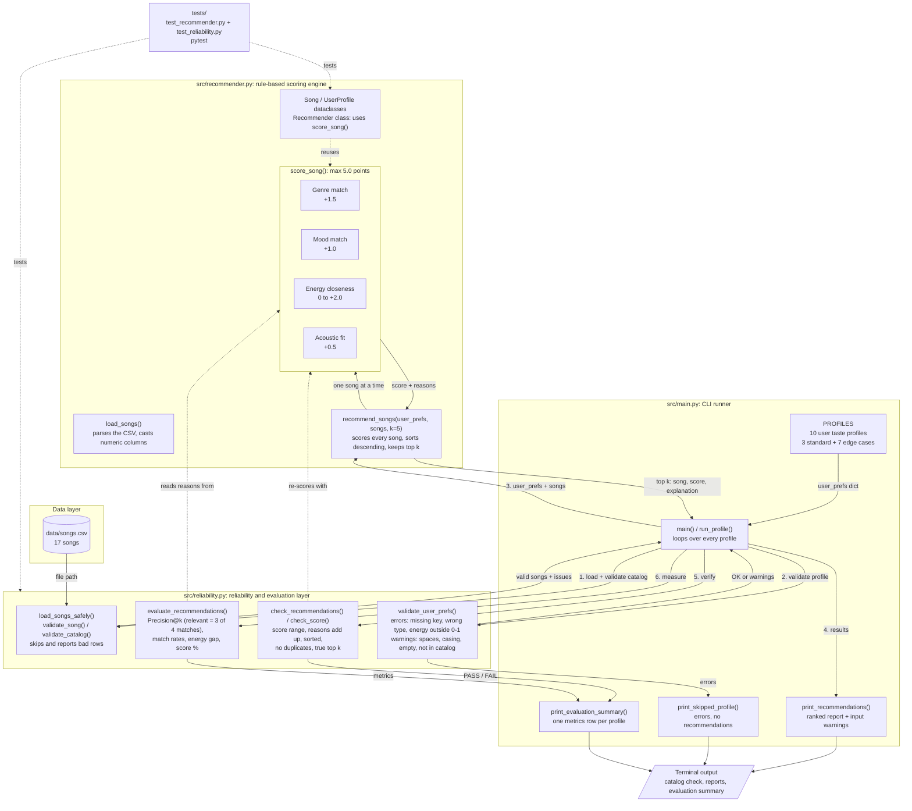

# 🎵 Music Recommender Simulation

## Summary

A rule-based, content-based music recommender that ranks songs from a 17-song catalog against a
listener's stated preferences (genre, mood, energy, and acoustic sound), and explains why each song was
picked. A reliability layer wraps the scoring engine. It rejects or flags bad input before scoring,
checks every ranking against the scoring rules after scoring, and measures each result list with
evaluation metrics such as Precision@k.

Why it matters: a recommender can return confident-looking results even when its input is broken or
its ranking is wrong. This project shows how to make a simple scoring system transparent, how to stop it
from quietly producing misleading output, and how to measure whether its recommendations actually follow
what the user asked for.

## Original Project

This project extends my **Music Recommender Simulation** from Modules 1–3. The original version loaded
songs from `data/songs.csv`, scored each one against a user taste profile using four weighted rules, and
printed the top 5 songs with a short explanation for each pick. It ran as a command-line simulation over
a set of standard and edge-case profiles. However, it had no input validation and no way to measure
result quality, so an impossible profile (such as energy 1.5) still received five recommendations that
looked trustworthy.

---

## Architecture Overview

The component diagram below is also stored as [diagrams/architecture.mmd](diagrams/architecture.mmd).



The system has four parts:

| Component | File | Role |
|---|---|---|
| Data layer | `data/songs.csv` | 17 songs with genre, mood, energy, tempo, valence, danceability, and acousticness |
| Scoring engine | `src/recommender.py` | `load_songs()`, `score_song()` (the four scoring rules, max 5.0 points), `recommend_songs()` (scores, sorts, keeps the top k), plus the `Song` / `UserProfile` / `Recommender` classes that reuse `score_song()` |
| Reliability layer | `src/reliability.py` | Validates the catalog and profiles, verifies each ranking, and computes evaluation metrics. It never changes how songs are scored. |
| CLI runner | `src/main.py` | Runs 10 profiles (3 standard + 7 edge cases), prints each report, and ends with an evaluation summary table |

The tests in `tests/` cover both the scoring engine and the reliability layer.

**Data flow for each run:**

```
data/songs.csv
        │
        ▼
1. load_songs_safely(): validate songs + catalog ──► bad rows skipped and reported
        │
        ▼
2. validate_user_prefs() for each profile ──► errors: profile skipped, errors printed
        │                                      warnings: printed, scoring continues
        ▼
3. recommend_songs(): score_song() for every song, sort highest first, keep top k
        │
        ▼
4. print the ranked report with reasons
        │
        ▼
5. check_recommendations(): re-score with score_song(), verify ranking ──► PASS / FAIL
        │
        ▼
6. evaluate_recommendations(): Precision@k, match rates, energy gap, score %
        │
        ▼
evaluation summary table (one row per profile)
```

The app exits with code 1 if the catalog can't be loaded or any verification check fails.

---

## How The System Works

Real-world recommenders like Spotify and YouTube learn what you like from your behavior and from the songs themselves. They give each song a score for how well it fits you, then rank the songs and show you the best matches. My version is a simple content-based recommender. It scores each song by comparing it to the user's preferences and then recommends the top results. It prioritizes genre first, then mood and how close the song's energy is to what the user wants, with a small bonus for matching their acoustic preference.

**Song features:** `genre`, `mood`, `energy`, `acousticness`

**UserProfile features:** `favorite_genre`, `favorite_mood`, `target_energy`, `likes_acoustic`

### Algorithm Recipe

For each song in the catalog, start at **0 points** and add:

| Rule | Points | Reasoning |
|---|---|---|
| Song `genre` equals user's `favorite_genre` | **+1.5** | Genre reflects long-term, stable taste. |
| Song `mood` equals user's `favorite_mood` | **+1.0** | Mood is situational, so it counts less than genre. |
| Energy closeness | **up to +2.0**, computed as `max(0, 2.0 × (1 − abs(song.energy − target_energy)))` | Continuous signal that separates songs even when no labels match. |
| Acoustic fit: `likes_acoustic` is True and `acousticness > 0.6`, **or** `likes_acoustic` is False and `acousticness ≤ 0.6` | **+0.5** | Small tiebreaker for the user's sound preference. |

**Maximum score:** 5.0 points.

**Ranking:** score every song, sort from highest to lowest score, and return the top `k` (default 5). Each recommendation includes a list of reasons, for example "genre match (+1.5)" or "energy close to target (+1.4)", so the user can see why it was picked.

**Why these weights balance:** everything except genre adds up to 3.5 points (1.0 + 2.0 + 0.5), and energy plus sound alone (2.5) beats the 1.5 genre bonus. A song from another genre with the right mood, energy and acoustic feel can still beat a genre match whose energy is far off. Genre leads, but it can't override everything else.

### Expected Biases

- **Genre over-prioritization:** genre is the largest single bonus, so the system might rank a mediocre song in the user's favorite genre above a great song that matches their mood and energy.
- **Exact-match labels are brittle:** "indie pop" gets no genre credit for a "pop" fan, and "relaxed" gets no mood credit for a "chill" listener, even though they're close.
- **Underrepresented genres and moods:** most genres and moods in `songs.csv` appear only once. Users whose favorites aren't in the catalog get recommendations based almost entirely on energy, and lofi/chill users have more songs to choose from than everyone else.
- **Energy acts as the default tiebreaker:** when no labels match, energy decides the ranking, so the results lean toward songs with similar intensity rather than variety.
- **No discovery:** the system only rewards similarity to what the user already likes, so it tends to keep users in a filter bubble.

---

## Reliability and Evaluation

The recommender is **rule-based**: it applies the fixed scoring rules above. It does not use machine
learning and does not learn from data. `src/reliability.py` adds a reliability and evaluation layer
around the scoring engine. This layer **never changes how songs are scored**. It checks the inputs,
verifies the outputs, and measures how well the results fit the user. Every check returns a list of
issues, and each issue is either:

- an **error**: the input or result can't be trusted
- a **warning**: it works, but may surprise the user

### 1. Validation (before scoring)

| Check | Function | Errors | Warnings |
|---|---|---|---|
| User preferences | `validate_user_prefs()` | missing key, wrong type, `target_energy` outside 0.0-1.0, `likes_acoustic` not True/False | empty genre/mood, extra spaces, unusual capitalization, genre/mood not in the catalog, unknown keys |
| One song | `validate_song()` | missing or blank field, non-numeric value, energy/valence/danceability/acousticness outside 0.0-1.0, tempo not positive | extra spaces in genre/mood |
| Whole catalog | `validate_catalog()` | empty catalog, duplicate ids | |
| CSV file | `load_songs_safely()` | missing columns; each bad row is skipped and reported instead of crashing the app | |

What the app does with the results:

- **A profile with errors gets no recommendations.** The app prints the errors instead, because the
  results would be misleading. Example: `Overdrive` (energy 1.5).
- **A profile with only warnings still gets recommendations**, with the warnings printed under its
  profile line. Preferences are never changed or cleaned up automatically. Example: `Whitespace Pop` is
  told that `' Pop '` will not match `pop` songs.
- **Bad catalog rows are skipped and listed** in the catalog check. If no valid songs remain, the app
  stops.

### 2. Verification (after scoring)

`check_recommendations()` re-checks every result list against the existing `score_song()`. It reuses
that function rather than keeping a second copy of the scoring rules, and confirms that:

- the list has `min(k, catalog size)` songs, with no song repeated
- each score and explanation is exactly what `score_song()` produces
- each score is between 0 and 5.0, and the points listed in its reasons add up to the score (within
  0.01, because the energy reason is printed to 2 decimals)
- "genre match" and "mood match" appear only when the labels really match
- the list is sorted from highest to lowest, and no song left out of the top k scores higher than a
  song that was kept

The summary shows `PASS` or `FAIL` for each profile. A failure means there's a bug in the code, not bad
input.

### 3. Evaluation metrics

`evaluate_recommendations()` measures each top-k list. Here k is the number of songs returned, and
every rate is between 0 and 1.

A song matches each of the user's **4 preferences** when:

- **genre**: `score_song()` gave it the genre bonus
- **mood**: `score_song()` gave it the mood bonus
- **energy**: `|song energy - target_energy| <= 0.2`
- **acoustic**: `score_song()` gave it the acoustic-fit bonus

| Metric | Formula | Meaning |
|---|---|---|
| **Precision@k** | (relevant songs in the top k) / k | Share of the recommendations that are strong matches |
| Best possible P@k | min(relevant songs in the catalog, k) / k | Highest Precision@k any top-k list could reach with this catalog |
| Genre / Mood / Energy / Acoustic rate | (top-k songs matching that preference) / k | Which preferences the list actually satisfies |
| Avg energy gap | average of (song energy - target_energy), ignoring the sign | Lower is better |
| Avg score % | average score / 5.0 x 100 | How close the songs come to a perfect match |
| Unique artists / genres | number of different values | Variety in the list |

**Definition of a relevant recommendation:** a song is *relevant* when it matches **at least 3 of the
4 preferences**. The threshold is 3, not 2, because in this catalog energy and acoustic fit almost
always match together (quiet songs are acoustic, loud songs are produced). With a threshold of 2,
nearly every profile scored a perfect 1.00, so the metric couldn't tell good lists from weak ones.

Relevance here comes from the user's stated preferences, not from real listening feedback. So
Precision@k measures *how closely the ranking follows the preferences*, not whether a real person would
enjoy the songs. When there are no results, every metric is `None` (shown as `-`), because dividing by
k = 0 is undefined.

**What the current results show:**

- For every valid profile, Precision@5 equals the best possible value. The ranking never misses a strong
  match that the catalog contains.
- Low scores (`Acoustic Metal` 0.20, `Contradictory Classical` 0.00) come from gaps in the 17-song
  catalog, not from the ranking.
- `Whitespace Pop` scores 0.40, compared with 0.60 for `High-Energy Pop`. That puts a number on the cost
  of the extra spaces.

---

## Design Decisions and Trade-offs

- **Rule-based scoring instead of machine learning.** There is no listening history to learn from, and
  every score has to be explainable. Fixed rules mean each recommendation can list exactly which points
  it earned and why. The trade-off: the system can't discover patterns that its rules don't describe.
- **Genre leads, but can't win alone.** Genre is the largest single bonus (+1.5), but energy plus
  acoustic fit (2.5) can outweigh it, so an off-genre song that fits everything else can still rank
  highly. Moving weight from genre to energy changed only 2 of the 10 profile rankings, which showed
  that most weaknesses come from gaps in the catalog, not from the weights.
- **Flag input problems, don't fix them silently.** Profiles with errors (for example, energy outside
  0.0–1.0) get no recommendations, because confident results built on bad input are worse than none.
  Warnings, such as extra spaces in a genre, are printed but the input is left unchanged, so the user
  sees the real cost of the problem (`Whitespace Pop` drops from 0.60 to 0.40 Precision@5).
- **Verify against the real scoring function.** `check_recommendations()` re-scores results with
  `score_song()` instead of keeping a second copy of the rules, so the checks can't drift away from the
  code they test.
- **A stricter relevance threshold.** A song counts as relevant only when it matches 3 of the 4
  preferences. A threshold of 2 gave almost every profile a perfect score, so it couldn't separate good
  lists from weak ones. Comparing Precision@k with the best value the catalog allows separates ranking
  problems from data problems.
- **Known limitation:** relevance comes from stated preferences, not real listener feedback, so the
  metrics measure how closely the ranking follows the profile, not whether someone would enjoy the
  songs. Exact-match labels ("indie pop" vs. "pop") and the small catalog are the biggest weaknesses.
  The [model card](model_card.md) discusses limitations and bias in more detail.

---

## Getting Started (Windows)

Tested with Python 3.14 on Windows 11. These commands are for PowerShell, run from the folder where
you want the project.

1. Clone the repository and open the project folder:

   ```powershell
   git clone https://github.com/nahom-ghebremedhn/applied-ai-system-project.git
   cd applied-ai-system-project
   ```

2. Create and activate a virtual environment:

   ```powershell
   python -m venv .venv
   .venv\Scripts\Activate.ps1
   ```

   If PowerShell blocks the activation script, run
   `Set-ExecutionPolicy -Scope CurrentUser RemoteSigned` once and try again. In Command Prompt, use
   `.venv\Scripts\activate.bat` instead.

3. Install dependencies:

   ```powershell
   pip install -r requirements.txt
   ```

4. Run the app (either command works):

   ```powershell
   python -m src.main
   python src/main.py
   ```

5. Run the tests:

   ```powershell
   python -m pytest
   ```

---

## Testing Summary

**In short:**

- All 72 automated tests pass.
- The ranking checks passed for all 9 valid profiles, and the invalid profile was rejected with an
  error instead of misleading results.
- For every valid profile, Precision@5 equals the best value the catalog allows.
- Low scores come from limited catalog fit, not ranking errors: Acoustic Metal (0.20) and Contradictory
  Classical (0.00) both reach the best Precision@5 the catalog allows. Input formatting problems lower
  quality (extra spaces drop Precision@5 from 0.60 to 0.40), and the system warns the user when this
  happens.
- Results improved after adding validation: the energy-1.5 profile no longer gets five misleading songs.
- An intentionally injected sorting bug was caught by 7 tests and by the app's own checks.

### Evaluation results by test case

Each row is one input from `python src/main.py` (or the bug experiment below), the behavior it should
show, and what actually happened. P@5 is Precision@5. "Best" is the highest P@5 this catalog allows.

| Test input | Evaluation criteria | Result |
|---|---|---|
| High-Energy Pop (pop, happy, 0.80, produced) | Best-fitting song ranks #1; ranking checks pass | Pass: #1 Sunrise City 4.96/5; P@5 0.60 (best 0.60) |
| Chill Lofi (lofi, chill, 0.35, acoustic) | Best-fitting song ranks #1; ranking checks pass | Pass: #1 Library Rain 5.00/5; P@5 0.80 (best 0.80) |
| Deep Intense Rock (rock, intense, 0.90, produced) | Best-fitting song ranks #1; ranking checks pass | Pass: #1 Storm Runner 4.98/5; P@5 0.40 (best 0.40) |
| Sad Gym Rat (mood "sad", not in the catalog) | Warn the user, still recommend | Pass: 1 warning; pop songs ranked #1–2; mood match rate 0.00 |
| Whitespace Pop (`' Pop '`, `'HAPPY'`) | Warn about input formatting, don't change the input silently | Pass, with a cost: 3 warnings; genre match lost, so P@5 is 0.40 vs. 0.60 for clean input |
| Overdrive (target energy 1.5) | Reject invalid input, give no recommendations | Pass: ERROR shown, profile skipped (before validation, it got 5 songs) |
| Contradictory Classical (classical, chill, 0.95, produced) | Handle conflicting preferences without crashing | No suitable catalog matches: runs and checks pass; P@5 0.00 equals the best possible (0.00) |
| Acoustic Metal (metal, angry, 0.97, acoustic) | Rank the best available matches correctly | Limited catalog fit: checks pass; #1 Iron Tempest matches genre, mood, and energy; acoustic match rate 0.00 because the catalog has no loud acoustic songs; P@5 0.20 equals the best possible (0.20) |
| Indie Pop Fan (multi-word genre "indie pop") | Multi-word genre matches exactly | Pass: #1 Rooftop Lights 5.00/5; P@5 0.40 (best 0.40) |
| No Preferences (empty genre and mood) | Warn, then rank by energy and sound only | Pass: 2 warnings; ranked by energy (average gap 0.18) |
| Injected bug: sort reversed to lowest-first | Tests and app checks must catch it | Pass: 7 of 72 tests failed; app marked every valid profile FAIL and exited with code 1 |

### Automated tests

All **72 tests pass** (`python -m pytest`; 51 test functions, some parametrized).

- **`tests/test_recommender.py`** (5 tests): the `Song` / `UserProfile` / `Recommender` interface,
  including sort order and agreement between `Recommender.recommend()` and `recommend_songs()` on the
  real catalog.
- **`tests/test_reliability.py`** (67 tests): profile validation (missing keys, wrong types,
  out-of-range or `NaN` energy, whitespace and capitalization warnings), song and catalog validation,
  safe CSV loading that skips bad rows, the ranking checks (wrong scores, duplicates, unsorted lists,
  a missed higher-scoring song), evaluation metrics checked by hand against a small hand-built catalog,
  and end-to-end runs of both app commands.

**Intentional sorting-bug experiment (AI-assisted).** To confirm the checks catch real bugs and not
just bad input, Claude (the AI coding assistant used on this project) temporarily changed the sort in
`recommend_songs()` from highest-first to lowest-first (`reverse=True` → `reverse=False`) and reran
the tests and the app (details in [ai_interactions.md](ai_interactions.md)):

- 7 of the 72 tests failed, including the real-catalog consistency test, the end-to-end ranking check,
  the metric tests, and both app-command tests.
- The app exited with code 1. Every valid profile showed `FAIL` in the Checks column, with messages
  such as `Velvet Hours scores 2.50 but was left out of the top 5, which includes a song scoring 1.44`.
- Precision@5 fell to 0.00 for every profile, while the "Best" column stayed unchanged. The gap between
  the two pointed directly at the ranking rather than the data.

The original sorting line was then restored, and all 72 tests passed again.

**What worked and what I learned:** the most useful checks compare the output to an independent source
of truth (re-scoring with `score_song()` and the "no better song was left out" check) instead of only
checking the output's shape. A bug that makes every result list look normal, with five songs and valid
scores, was caught immediately by these checks. Testing the metrics on a small hand-built catalog, where
the right answers can be worked out by hand, also made the evaluation numbers trustworthy.

---

## Sample Interactions

Unedited output of `python src/main.py` (17 songs loaded), one block per profile. Each run starts with
`Catalog check: 17 valid songs, 0 errors, 0 warnings`. Any input warnings for a profile appear under
its profile line, and the run ends with an evaluation summary table (see below).

### Standard profiles

#### High-Energy Pop

```
============================================================
            TOP RECOMMENDATIONS: High-Energy Pop
============================================================
 Profile: pop | happy | energy 0.80 | produced
------------------------------------------------------------
 #1  Sunrise City  by Neon Echo
     Score: 4.96 / 5.00
     Why:
       - genre match (+1.5)
       - mood match (+1.0)
       - energy close to target (+1.96)
       - produced (non-acoustic) sound fits preference (+0.5)
------------------------------------------------------------
 #2  Gym Hero  by Max Pulse
     Score: 3.74 / 5.00
     Why:
       - genre match (+1.5)
       - energy close to target (+1.74)
       - produced (non-acoustic) sound fits preference (+0.5)
------------------------------------------------------------
 #3  Rooftop Lights  by Indigo Parade
     Score: 3.42 / 5.00
     Why:
       - mood match (+1.0)
       - energy close to target (+1.92)
       - produced (non-acoustic) sound fits preference (+0.5)
------------------------------------------------------------
 #4  Concrete Crown  by Block Theory
     Score: 2.46 / 5.00
     Why:
       - energy close to target (+1.96)
       - produced (non-acoustic) sound fits preference (+0.5)
------------------------------------------------------------
 #5  Night Drive Loop  by Neon Echo
     Score: 2.40 / 5.00
     Why:
       - energy close to target (+1.90)
       - produced (non-acoustic) sound fits preference (+0.5)
------------------------------------------------------------
```

#### Chill Lofi

```
============================================================
               TOP RECOMMENDATIONS: Chill Lofi
============================================================
 Profile: lofi | chill | energy 0.35 | acoustic
------------------------------------------------------------
 #1  Library Rain  by Paper Lanterns
     Score: 5.00 / 5.00
     Why:
       - genre match (+1.5)
       - mood match (+1.0)
       - energy close to target (+2.00)
       - acoustic sound fits preference (+0.5)
------------------------------------------------------------
 #2  Midnight Coding  by LoRoom
     Score: 4.86 / 5.00
     Why:
       - genre match (+1.5)
       - mood match (+1.0)
       - energy close to target (+1.86)
       - acoustic sound fits preference (+0.5)
------------------------------------------------------------
 #3  Focus Flow  by LoRoom
     Score: 3.90 / 5.00
     Why:
       - genre match (+1.5)
       - energy close to target (+1.90)
       - acoustic sound fits preference (+0.5)
------------------------------------------------------------
 #4  Spacewalk Thoughts  by Orbit Bloom
     Score: 3.36 / 5.00
     Why:
       - mood match (+1.0)
       - energy close to target (+1.86)
       - acoustic sound fits preference (+0.5)
------------------------------------------------------------
 #5  Coffee Shop Stories  by Slow Stereo
     Score: 2.46 / 5.00
     Why:
       - energy close to target (+1.96)
       - acoustic sound fits preference (+0.5)
------------------------------------------------------------
```

#### Deep Intense Rock

```
============================================================
           TOP RECOMMENDATIONS: Deep Intense Rock
============================================================
 Profile: rock | intense | energy 0.90 | produced
------------------------------------------------------------
 #1  Storm Runner  by Voltline
     Score: 4.98 / 5.00
     Why:
       - genre match (+1.5)
       - mood match (+1.0)
       - energy close to target (+1.98)
       - produced (non-acoustic) sound fits preference (+0.5)
------------------------------------------------------------
 #2  Gym Hero  by Max Pulse
     Score: 3.44 / 5.00
     Why:
       - mood match (+1.0)
       - energy close to target (+1.94)
       - produced (non-acoustic) sound fits preference (+0.5)
------------------------------------------------------------
 #3  Pulse Theory  by Kilowatt Kids
     Score: 2.40 / 5.00
     Why:
       - energy close to target (+1.90)
       - produced (non-acoustic) sound fits preference (+0.5)
------------------------------------------------------------
 #4  Iron Tempest  by Grave Signal
     Score: 2.36 / 5.00
     Why:
       - energy close to target (+1.86)
       - produced (non-acoustic) sound fits preference (+0.5)
------------------------------------------------------------
 #5  Sunrise City  by Neon Echo
     Score: 2.34 / 5.00
     Why:
       - energy close to target (+1.84)
       - produced (non-acoustic) sound fits preference (+0.5)
------------------------------------------------------------
```

### Adversarial / edge-case profiles

#### Sad Gym Rat

```
============================================================
              TOP RECOMMENDATIONS: Sad Gym Rat
============================================================
 Profile: pop | sad | energy 0.90 | produced
 Input warnings:
   ! WARNING: favorite_mood 'sad' does not appear in the
     catalog, so no song can earn the mood bonus.
------------------------------------------------------------
 #1  Gym Hero  by Max Pulse
     Score: 3.94 / 5.00
     Why:
       - genre match (+1.5)
       - energy close to target (+1.94)
       - produced (non-acoustic) sound fits preference (+0.5)
------------------------------------------------------------
 #2  Sunrise City  by Neon Echo
     Score: 3.84 / 5.00
     Why:
       - genre match (+1.5)
       - energy close to target (+1.84)
       - produced (non-acoustic) sound fits preference (+0.5)
------------------------------------------------------------
 #3  Storm Runner  by Voltline
     Score: 2.48 / 5.00
     Why:
       - energy close to target (+1.98)
       - produced (non-acoustic) sound fits preference (+0.5)
------------------------------------------------------------
 #4  Pulse Theory  by Kilowatt Kids
     Score: 2.40 / 5.00
     Why:
       - energy close to target (+1.90)
       - produced (non-acoustic) sound fits preference (+0.5)
------------------------------------------------------------
 #5  Iron Tempest  by Grave Signal
     Score: 2.36 / 5.00
     Why:
       - energy close to target (+1.86)
       - produced (non-acoustic) sound fits preference (+0.5)
------------------------------------------------------------
```

#### Whitespace Pop

```
============================================================
             TOP RECOMMENDATIONS: Whitespace Pop
============================================================
 Profile:  Pop  | HAPPY | energy 0.80 | produced
 Input warnings:
   ! WARNING: favorite_genre ' Pop ' has extra spaces.
     Scoring compares the text exactly (ignoring case), so
     it will NOT match 'pop' songs.
   ! WARNING: favorite_genre ' Pop ' has unusual
     capitalization. Scoring ignores case, so it is treated
     as 'pop'.
   ! WARNING: favorite_mood 'HAPPY' has unusual
     capitalization. Scoring ignores case, so it is treated
     as 'happy'.
------------------------------------------------------------
 #1  Sunrise City  by Neon Echo
     Score: 3.46 / 5.00
     Why:
       - mood match (+1.0)
       - energy close to target (+1.96)
       - produced (non-acoustic) sound fits preference (+0.5)
------------------------------------------------------------
 #2  Rooftop Lights  by Indigo Parade
     Score: 3.42 / 5.00
     Why:
       - mood match (+1.0)
       - energy close to target (+1.92)
       - produced (non-acoustic) sound fits preference (+0.5)
------------------------------------------------------------
 #3  Concrete Crown  by Block Theory
     Score: 2.46 / 5.00
     Why:
       - energy close to target (+1.96)
       - produced (non-acoustic) sound fits preference (+0.5)
------------------------------------------------------------
 #4  Night Drive Loop  by Neon Echo
     Score: 2.40 / 5.00
     Why:
       - energy close to target (+1.90)
       - produced (non-acoustic) sound fits preference (+0.5)
------------------------------------------------------------
 #5  Storm Runner  by Voltline
     Score: 2.28 / 5.00
     Why:
       - energy close to target (+1.78)
       - produced (non-acoustic) sound fits preference (+0.5)
------------------------------------------------------------
```

#### Overdrive

```
============================================================
               TOP RECOMMENDATIONS: Overdrive
============================================================
 Profile: {'favorite_genre': 'lofi', 'favorite_mood': 'chill', 'target_energy': 1.5, 'likes_acoustic': True}
 NO RECOMMENDATIONS: the profile has invalid input.
   ! ERROR: target_energy 1.5 is outside 0.0-1.0. Every
     song's energy is in that range, so the loudest or
     quietest songs would look 'closest' by mistake.
------------------------------------------------------------
```

Before the reliability layer, this profile still got five songs, and a metal song slipped in at #5 because energy 1.5 makes the loudest song look "closest". Now its recommendations are withheld and a clear error is shown instead of misleading results.

#### Contradictory Classical

```
============================================================
        TOP RECOMMENDATIONS: Contradictory Classical
============================================================
 Profile: classical | chill | energy 0.95 | produced
------------------------------------------------------------
 #1  Pulse Theory  by Kilowatt Kids
     Score: 2.50 / 5.00
     Why:
       - energy close to target (+2.00)
       - produced (non-acoustic) sound fits preference (+0.5)
------------------------------------------------------------
 #2  Gym Hero  by Max Pulse
     Score: 2.46 / 5.00
     Why:
       - energy close to target (+1.96)
       - produced (non-acoustic) sound fits preference (+0.5)
------------------------------------------------------------
 #3  Iron Tempest  by Grave Signal
     Score: 2.46 / 5.00
     Why:
       - energy close to target (+1.96)
       - produced (non-acoustic) sound fits preference (+0.5)
------------------------------------------------------------
 #4  Storm Runner  by Voltline
     Score: 2.42 / 5.00
     Why:
       - energy close to target (+1.92)
       - produced (non-acoustic) sound fits preference (+0.5)
------------------------------------------------------------
 #5  Sunrise City  by Neon Echo
     Score: 2.24 / 5.00
     Why:
       - energy close to target (+1.74)
       - produced (non-acoustic) sound fits preference (+0.5)
------------------------------------------------------------
```

#### Acoustic Metal

```
============================================================
             TOP RECOMMENDATIONS: Acoustic Metal
============================================================
 Profile: metal | angry | energy 0.97 | acoustic
------------------------------------------------------------
 #1  Iron Tempest  by Grave Signal
     Score: 4.50 / 5.00
     Why:
       - genre match (+1.5)
       - mood match (+1.0)
       - energy close to target (+2.00)
------------------------------------------------------------
 #2  Pulse Theory  by Kilowatt Kids
     Score: 1.96 / 5.00
     Why:
       - energy close to target (+1.96)
------------------------------------------------------------
 #3  Gym Hero  by Max Pulse
     Score: 1.92 / 5.00
     Why:
       - energy close to target (+1.92)
------------------------------------------------------------
 #4  Storm Runner  by Voltline
     Score: 1.88 / 5.00
     Why:
       - energy close to target (+1.88)
------------------------------------------------------------
 #5  Sunrise City  by Neon Echo
     Score: 1.70 / 5.00
     Why:
       - energy close to target (+1.70)
------------------------------------------------------------
```

#### Indie Pop Fan

```
============================================================
             TOP RECOMMENDATIONS: Indie Pop Fan
============================================================
 Profile: indie pop | happy | energy 0.76 | produced
------------------------------------------------------------
 #1  Rooftop Lights  by Indigo Parade
     Score: 5.00 / 5.00
     Why:
       - genre match (+1.5)
       - mood match (+1.0)
       - energy close to target (+2.00)
       - produced (non-acoustic) sound fits preference (+0.5)
------------------------------------------------------------
 #2  Sunrise City  by Neon Echo
     Score: 3.38 / 5.00
     Why:
       - mood match (+1.0)
       - energy close to target (+1.88)
       - produced (non-acoustic) sound fits preference (+0.5)
------------------------------------------------------------
 #3  Night Drive Loop  by Neon Echo
     Score: 2.48 / 5.00
     Why:
       - energy close to target (+1.98)
       - produced (non-acoustic) sound fits preference (+0.5)
------------------------------------------------------------
 #4  Concrete Crown  by Block Theory
     Score: 2.46 / 5.00
     Why:
       - energy close to target (+1.96)
       - produced (non-acoustic) sound fits preference (+0.5)
------------------------------------------------------------
 #5  Storm Runner  by Voltline
     Score: 2.20 / 5.00
     Why:
       - energy close to target (+1.70)
       - produced (non-acoustic) sound fits preference (+0.5)
------------------------------------------------------------
```

#### No Preferences

```
============================================================
             TOP RECOMMENDATIONS: No Preferences
============================================================
 Profile:  |  | energy 0.50 | produced
 Input warnings:
   ! WARNING: favorite_genre is empty, so no song can earn
     the genre bonus.
   ! WARNING: favorite_mood is empty, so no song can earn
     the mood bonus.
------------------------------------------------------------
 #1  Velvet Hours  by Amara Soul
     Score: 2.50 / 5.00
     Why:
       - energy close to target (+2.00)
       - produced (non-acoustic) sound fits preference (+0.5)
------------------------------------------------------------
 #2  Island Bloom  by Sol Rhythm
     Score: 2.30 / 5.00
     Why:
       - energy close to target (+1.80)
       - produced (non-acoustic) sound fits preference (+0.5)
------------------------------------------------------------
 #3  Night Drive Loop  by Neon Echo
     Score: 2.00 / 5.00
     Why:
       - energy close to target (+1.50)
       - produced (non-acoustic) sound fits preference (+0.5)
------------------------------------------------------------
 #4  Rooftop Lights  by Indigo Parade
     Score: 1.98 / 5.00
     Why:
       - energy close to target (+1.48)
       - produced (non-acoustic) sound fits preference (+0.5)
------------------------------------------------------------
 #5  Concrete Crown  by Block Theory
     Score: 1.94 / 5.00
     Why:
       - energy close to target (+1.44)
       - produced (non-acoustic) sound fits preference (+0.5)
------------------------------------------------------------
```

### Evaluation summary

Printed once at the end of every run, after all the profile reports:

```
=========================================================================================
                                    EVALUATION SUMMARY
=========================================================================================
Profile                 Input      P@5  Best Genre  Mood  Enrg  Acou   Gap  Score  Checks
-----------------------------------------------------------------------------------------
High-Energy Pop         OK        0.60  0.60  0.40  0.40  1.00  1.00  0.05    68%  PASS
Chill Lofi              OK        0.80  0.80  0.60  0.60  1.00  1.00  0.04    78%  PASS
Deep Intense Rock       OK        0.40  0.40  0.20  0.40  1.00  1.00  0.05    62%  PASS
Sad Gym Rat             WARN(1)   0.40  0.40  0.40  0.00  1.00  1.00  0.05    60%  PASS
Whitespace Pop          WARN(3)   0.40  0.40  0.00  0.40  1.00  1.00  0.05    56%  PASS
Overdrive               ERROR        -     -     -     -     -     -     -      -  -
Contradictory Classical OK        0.00  0.00  0.00  0.00  1.00  1.00  0.04    48%  PASS
Acoustic Metal          OK        0.20  0.20  0.20  0.20  1.00  0.00  0.05    48%  PASS
Indie Pop Fan           OK        0.40  0.40  0.20  0.40  1.00  1.00  0.05    62%  PASS
No Preferences          WARN(2)   0.00  0.00  0.00  0.00  0.40  1.00  0.18    43%  PASS
-----------------------------------------------------------------------------------------
 P@5: share of the top 5 matching at least 3 of the 4 preferences
       (genre, mood, energy within 0.2, acoustic fit).
 Best: highest P@5 this catalog allows. Genre/Mood/Enrg/Acou: match rates.
 Gap: average |energy - target|. Score: average score as % of the max.
 Input: OK, WARN(n) warnings, or ERROR (profile skipped).
 Checks: PASS if scores, explanations and ranking were verified.
```

---

## Reflection

This project showed me that a working AI system and a trustworthy one are not the same thing. The
original recommender already gave reasonable-looking top 5 lists, but nothing told me when those lists
were built on impossible input or a broken ranking. Adding validation, verification, and metrics made
the system honest about its own results. It also changed how I debug: the evaluation table showed that
low scores came from gaps in the catalog, not the weights, which saved me from tuning numbers that were
not the real problem.

It also changed how I approach problem-solving. Defining a measurable target first, such as "relevant
means 3 of 4 preferences match," made design choices easier to test and argue for. Deliberately breaking
the code was the clearest way to prove the checks work. I also learned to check AI-assisted work against
the real output rather than trusting summaries. Every sample in this README comes from an actual run.

Responsible-AI considerations, limitations, and bias analysis are in the [model card](model_card.md).


## Portfolio Artifact

**Project:** VibeMatch – Music Recommendation System

**GitHub Repository:** [View my project on GitHub](https://github.com/nahom-ghebremedhn/applied-ai-system-project)

### What This Project Says About Me as an Aspiring AI Engineer.

This project reflects my interest in building reliable, responsible, and useful AI systems. Through extending and improving VibeMatch, I learned that building an AI application involves more than generating recommendations. It also requires validating inputs, testing different scenarios, evaluating results, and understanding the limitations of the data. I strengthened my Python programming, object-oriented design, software testing, and problem-solving skills while improving an existing recommendation system. I also learned to use AI tools as development assistants while reviewing their suggestions, checking their work, and making independent decisions. This experience has motivated me to continue exploring AI engineering and building systems that are transparent, dependable, and useful.


